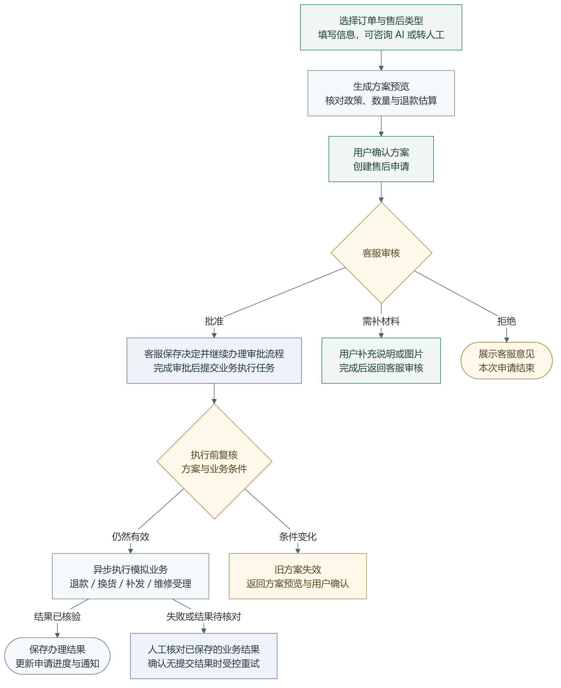

# 青禾 · AI 电商售后服务台

青禾是一套面向用户与客服的电商售后应用，将订单查询、AI 咨询、售后申请、人工审批与业务办理串联在同一个工作台中。支持 **退款、换货、补发、维修** 四类售后场景，用户可以查看申请进度，客服可以核对材料、处理审批和跟踪办理结果。

**核心流程：** 查询订单 → 生成售后方案 → 用户确认 → 客服审批 → 提交业务执行 → 查看办理结果。

> 当前项目使用模拟订单、支付、库存和物流，适合本机演示与功能体验。维修结果表示已受理，未接入真实企业订单或支付系统。

## 核心功能

| 功能 | 页面与能力 |
| --- | --- |
| 订单查询 | 用户查看自己的订单、商品、支付与售后历史；客服查询全部模拟订单，并查看集中待办。 |
| 售后申请 | 按步骤选择售后类型、商品和数量，填写原因与收货情况，补充文字或图片材料。 |
| 方案预览 | 展示申请资格、数量依据、退款估算与政策依据；用户核对并确认当前方案后进入审批。 |
| AI 咨询 | 关联订单开展多轮咨询，结合订单、物流、库存、历史售后与政策信息生成建议和方案。 |
| 人工协作 | 用户可转人工；客服接单、回复并结束服务，接管期间暂停助手自动回复。 |
| 审批与办理 | 客服批准、拒绝或请求补充材料，提交执行任务；用户查看退款、发货或维修受理结果。 |
| 运营与管理 | 提供库存查询、任务与异常处理、政策版本管理、站内通知和管理员账号管理。 |

用户数据按账号隔离。客服拥有业务处理权限；管理员还可创建客服账号、核实请求后重置密码。

## 项目流程

下图展示主要业务路径，以及补充材料、方案失效和办理异常时的处理分支。



**流程中的关键约束：**

- **咨询与申请分开：** AI 提供查询、解释和方案建议；用户确认方案后才创建售后申请。
- **审批与执行分开：** 客服保存审批决定、继续办理审批流程后，还需提交业务执行任务。
- **方案绑定版本：** 确认、审批和执行复核针对同一方案；订单、库存或政策等相关条件变化时，需要重新生成并确认。
- **异常先核对结果：** 执行失败或响应丢失时，核对账本和已保存结果，再决定受控重试或人工处理，降低重复退款或发货风险。

[查看可编辑流程图](figures/after-sales-workflow.md) · [Mermaid 源文件](figures/after-sales-workflow.mmd)

## 技术实现

| 层次 | 技术与职责 |
| --- | --- |
| 前端工作台 | Vue 3、TypeScript、Element Plus、Pinia、Vue Router：组织用户与客服页面、表单和办理状态。 |
| 服务接口 | FastAPI：提供登录鉴权、订单、申请、审批、材料、咨询与管理接口。 |
| Agent 编排 | LangGraph：组织问题识别、订单核验、政策判断和方案生成等专职子图。 |
| 业务工具 | MCP 工具边界与适配接口：按权限访问订单、物流、库存、政策和执行服务。 |
| 数据存储 | PostgreSQL：保存订单、方案、申请、审批记录、执行结果和咨询历史。 |
| 异步与进度 | 咨询、审批与执行由后台任务处理，SSE 推送进度；支持 PostgreSQL 队列或 Kafka，Kafka 模式结合 Redis 协调任务处理。 |
| 本机运行 | PowerShell 脚本与 Docker Compose：提供环境准备、前端构建、模拟业务服务和启动入口。 |

业务规则负责校验售后资格、数量、金额和政策条件。Agent 的工具访问按角色和工具白名单约束；执行层结合幂等记录、库存预留和结果核对处理重复请求与异常响应。业务适配层支持数据库模拟实现和独立 HTTP 模拟服务，便于替换接口后继续验证流程。

## 核心页面

保留 6 张实际页面截图，点击展开查看。截图使用已有模拟数据，其中 AI 咨询图展示初始页面。

<details>
<summary><strong>订单与售后申请</strong></summary>

从订单查看商品和业务信息，选择售后类型并填写申请内容。


</details>

<details>
<summary><strong>AI 咨询与人工协作</strong></summary>

咨询关联订单，需要时转交客服；客服在人工咨询工作台接单并跟进。


</details>

<details>
<summary><strong>客服审批与办理结果</strong></summary>

客服核对用户确认的方案和材料；用户查看申请状态、客服意见和已核验的办理结果。


</details>

## 快速体验

安装并启动 Docker Desktop 后，在 PowerShell 执行：

```powershell
git clone https://github.com/chen-xinyi111/qinghe-after-sales.git
cd qinghe-after-sales
Set-ExecutionPolicy -Scope Process -ExecutionPolicy RemoteSigned
.\scripts\local\Docker.ps1 -Action Start
```

执行策略设置仅对当前 PowerShell 进程及其子进程有效。首次运行会构建应用并生成本机配置，启动后打开 [青禾工作台](http://127.0.0.1:18080/app/)。

默认使用离线模拟模型，无需 API Key。演示用户为 `user001`，演示客服为 `staff001`，公共模拟密码为 `Demo-1101!`。这些账号用于模拟数据体验。

Windows 开发环境使用 `8080` 端口；完整安装、启停和真实模型配置见 [本机运行说明](docs/RUNNING.md)。

## 目录结构

```text
frontend/               用户与客服工作台
src/agents/after_sales/ 售后 Agent、子图与工具
src/commerce/           业务接口、规则、数据库与后台任务
data/                   模拟业务数据
scripts/                启动、构建与检查脚本
tests/                  自动检查与业务测试
docker/                 容器配置
docs/                   运行说明、API 类型与核心截图
figures/                项目流程图及可编辑源文件
```

## 开源来源

本项目基于 [agent-service-toolkit](https://github.com/JoshuaC215/agent-service-toolkit) 扩展，保留原 MIT 许可证和版权声明。来源说明见 [NOTICE](NOTICE.md)，许可见 [LICENSE](LICENSE)。
